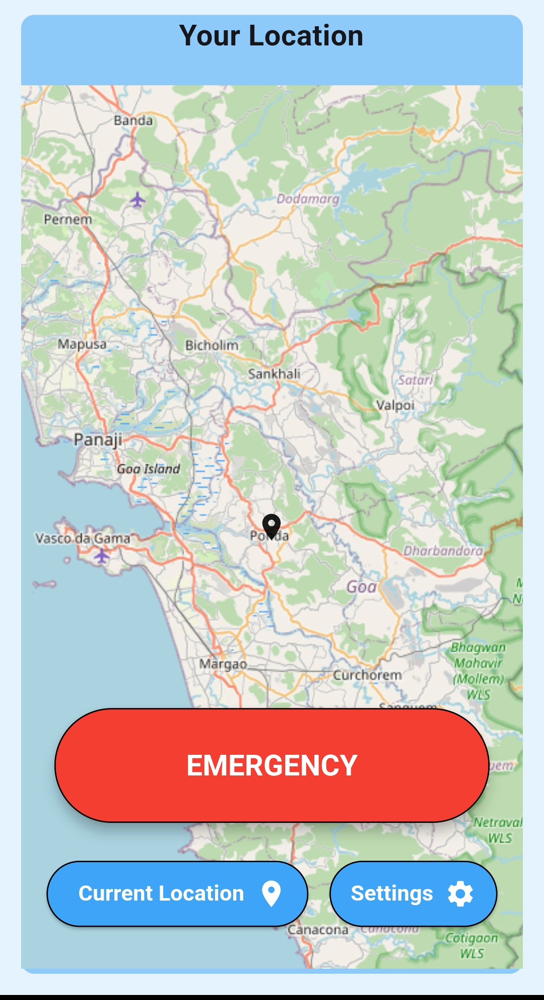
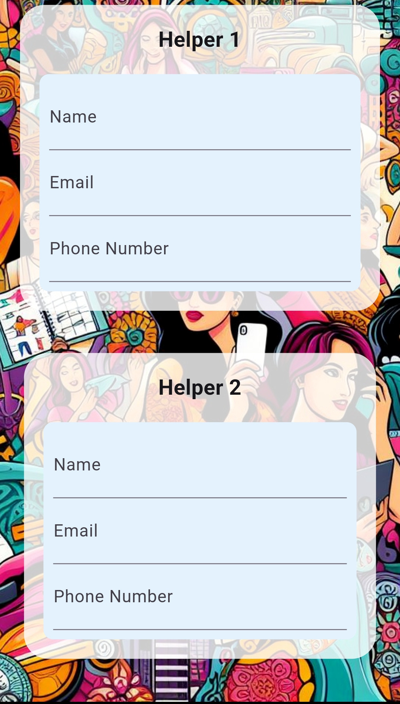
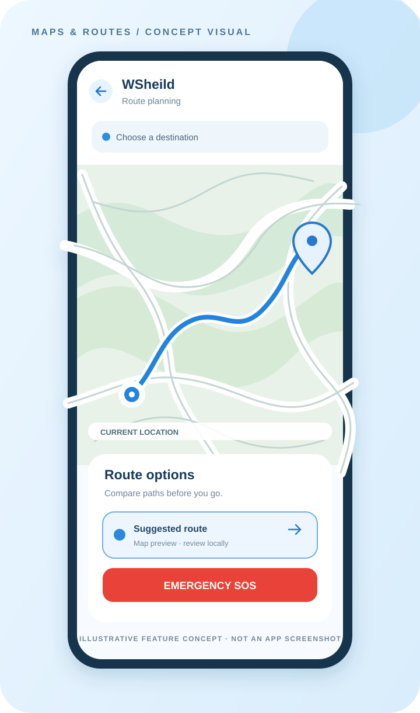
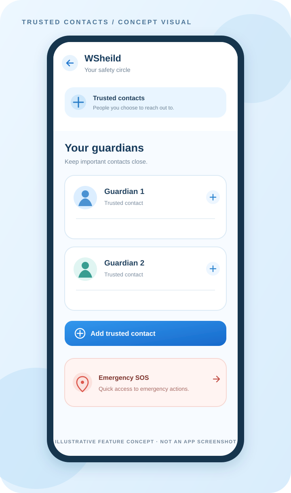

# WSheild

WSheild is a Flutter mobile app exploring practical safety tools for everyday travel: location sharing, emergency actions, safer route discovery, and trusted contacts in one place.

## Screenshots

<table>
  <tr>
    <td align="center" width="50%"></td>
    <td align="center" width="50%"></td>
  </tr>
  <tr>
    <td align="center"><strong>Location and emergency screen</strong> A map view with current location and a prominent emergency action.</td>
    <td align="center"><strong>Trusted guardians</strong> Contact details for people to reach when support is needed.</td>
  </tr>
</table>

<table>
  <tr>
    <td align="center" width="50%"></td>
    <td align="center" width="50%"></td>
  </tr>
  <tr>
    <td align="center"><strong>Route planning</strong> Map paths and an emergency action.</td>
    <td align="center"><strong>Trusted contacts</strong> Guardian management with quick emergency access.</td>
  </tr>
</table>

## Features

- Emergency action designed for quick access.
- Location and map views for situational awareness.
- Safe route and place discovery using OpenStreetMap and Photon.
- Trusted guardian contact management.
- Safety information and community alert concepts.

## Tech stack

- Flutter and Dart
- Google Maps Flutter and Flutter Map
- Location and geocoding packages
- OpenStreetMap and Photon
- Hive for local storage
- HTTP and URL Launcher

## Run locally

1. Install Flutter and configure an Android or iOS device/emulator.
2. Clone this repository and run `flutter pub get`.
3. Configure the required values in the local `.env` file. Keep secrets out of commits.
4. Run `flutter run`.

The screenshots are app captures cropped to focus on the relevant interface. The map screenshot omits the legacy in-app title bar so the README consistently identifies the project as WSheild.
